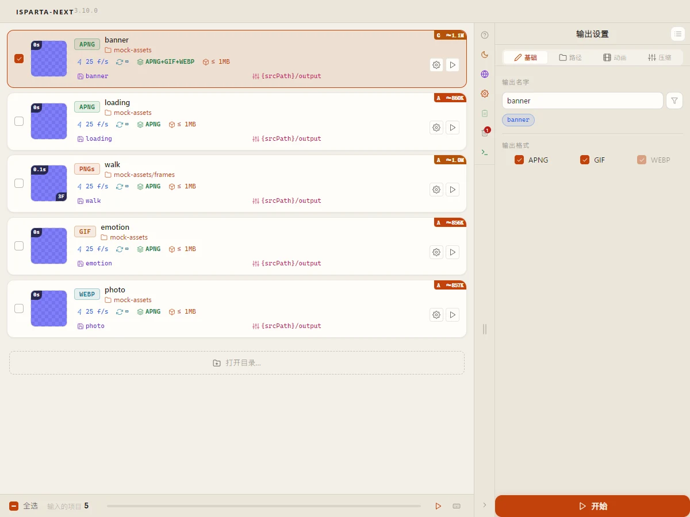
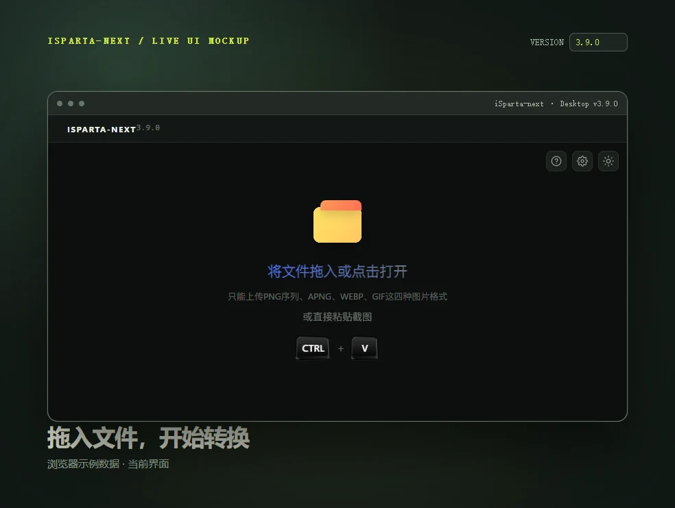
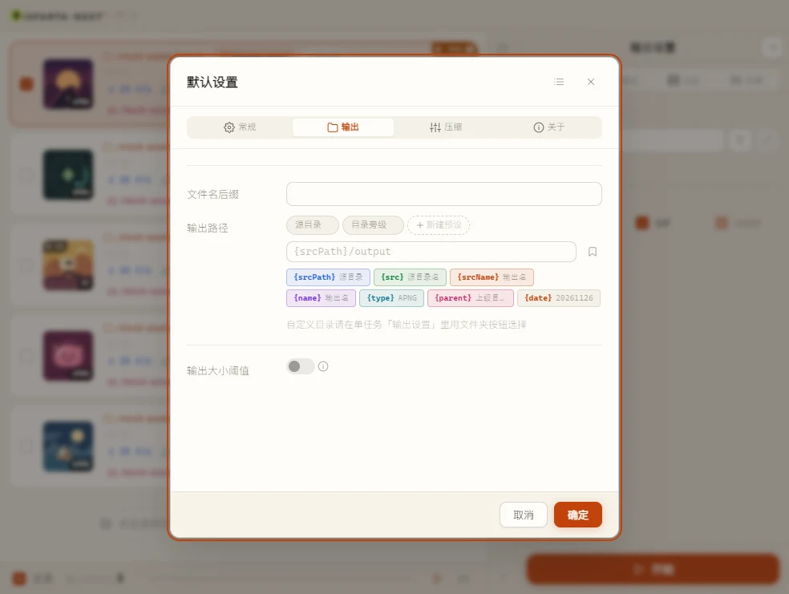
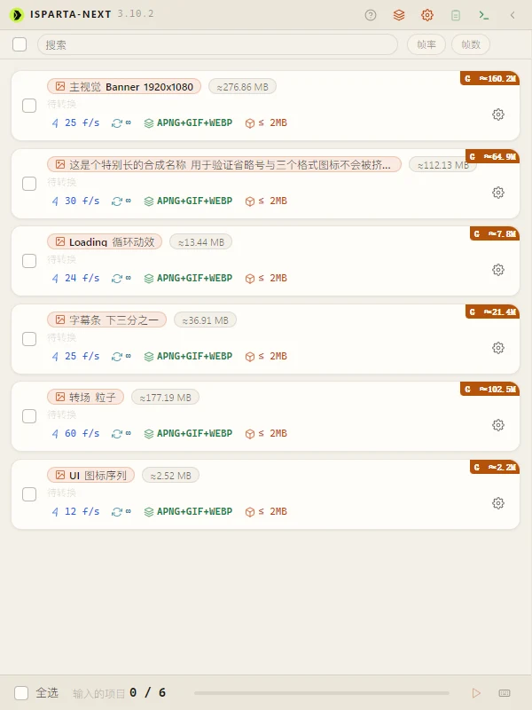
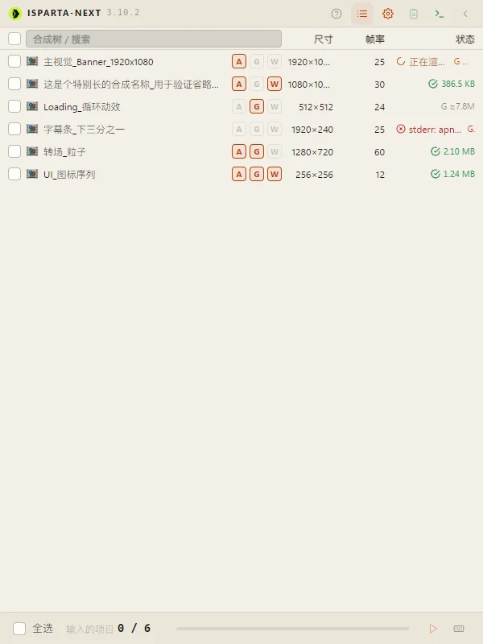
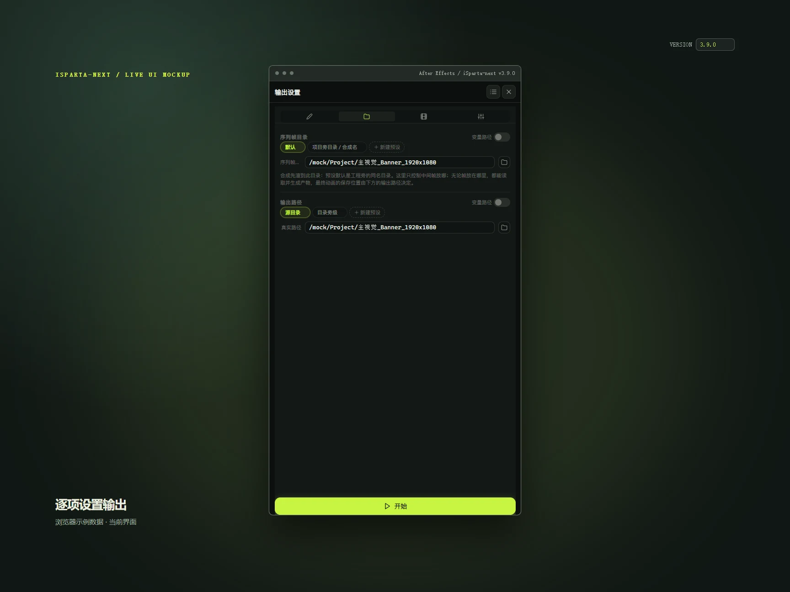
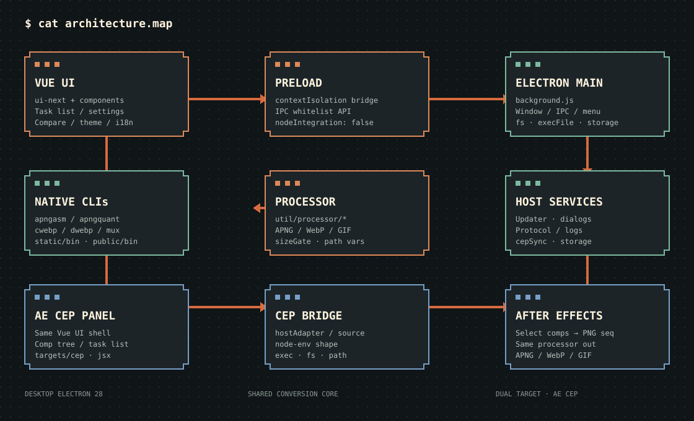

<div align="center">


<h1>iSparta-next</h1>

<p>Convert and compress APNG / Animated WebP / GIF / PNG sequences.</p>

<p><i>A modern, maintained rebuild of the long-abandoned classic iSparta, on Electron 28 + Vue 2. All conversion happens locally — nothing is uploaded.</i></p>

<p>
  <a href="https://github.com/yancongya/iSparta-next/releases"></a>
  <a href="https://github.com/yancongya/iSparta-next/releases"></a>
  <a href="https://github.com/yancongya/iSparta-next/releases"></a>
</p>

<p>
  <a href="https://github.com/yancongya/iSparta-next/releases"></a>
  
  
  
</p>

<p><a href="https://github.com/yancongya/iSparta-next/releases"><b>Download installers →</b></a> · <a href="https://yancongya.github.io/iSparta-next/">Product page</a> · <a href="README.md">中文</a></p>



</div>

**iSparta-next** is a desktop animated-image converter rebuilt from the classic [iSparta](https://github.com/iSparta/iSparta). It converts and compresses **APNG / Animated WebP / GIF / PNG sequences**, and can be called directly from an After Effects panel.

> **Docs:** [Changelog & updater](docs/CHANGELOG.md) · [Release process](docs/RELEASE.md) · [Docs map](#docs-map) · [SEO checklist](docs/SEO_SUBMIT.md)

### Updates & auto-update

- Roughly 8 seconds after launch the app checks **GitHub Releases** once (version + OS type only; turn it off in **Settings → Automatic update check**). When an update exists, a non-blocking corner card appears in-app; confirm to download, then **Restart to update**.
- **Windows (NSIS) / Linux (AppImage) / macOS (pkg)** all support in-app updates; macOS asks for administrator permission. CI packages are unsigned, so the OS may ask you to allow opening. The **AE panel** reuses the same official installer and needs an After Effects restart afterwards.
- Mechanics, architecture and limitations: [`docs/CHANGELOG.md`](docs/CHANGELOG.md#更新机制); release process: [`docs/RELEASE.md`](docs/RELEASE.md); free Windows signing: [`docs/SIGNPATH.md`](docs/SIGNPATH.md).

> **Install and update:** Windows and macOS installers are system-wide; the matching CEP extension is deployed when After Effects is detected. Desktop and AE panel share the same official installer — restart the app or After Effects when prompted. AE panel capabilities and upgrade boundary: [`docs/CEP-UPGRADE-SCOPE.md`](docs/CEP-UPGRADE-SCOPE.md).

### Recent highlights

- **Compression routes:** choose quality or a fixed 2–256 color palette for APNG / GIF; size-limit retries step through color presets, and estimate badges cycle through output formats
- **Sequence import:** numbered files such as `ah16_06.pcx.png` are grouped into one task
- **AE panel:** one-button switch between comp tree and task list; the comp tree shows run status and output size, supports draggable column widths and per-comp output formats; double-click a row to open output settings, right-click to jump to a comp / open its location / output folder / stop task; with multiple tasks selected, the toolbar batch settings button opens shared settings; pinned filter bar
- **Tasks and output:** per-comp settings persist; default output names come from composition names, while custom names are preserved; completed rows show final output size plus clickable format badges; copying files reports progress and result
- **Grouped settings:** output and global settings use pinned top tabs (Basics / Paths / Animation / Compression); the narrow AE panel collapses to icon-only tabs, with no height jump between tabs
- **Size estimate & self-check:** the starting setting is estimated from the target size before conversion, and the estimated output size (≈xx KB/MB, click a badge to cycle formats, hover for the full breakdown) stays visible on task cards and in the comp-tree status column even with the limit off; sequences count every frame's source size; encoder binaries are hash-checked with automatic fallback to a healthy copy, with results viewable under "About"
- **Output actions:** copy completed files; hold Alt while hovering the toolbar button to open the output folder
- **Bundled install:** system-wide installation (UAC prompt, CEP under Common Files, a single copy per machine); auto-detects the AE version; version shown in both the desktop title bar and the AE panel
- **Onboarding (7 pages):** Welcome → Import → Output → Naming → Path variables → AE → Done, with a fluid glow backdrop, covering import methods, output settings and naming rules in one pass
- **Unified brand mark:** Desktop, AE CEP panel, and landing page share a unified static-by-default, animated-on-hover brand logo interaction; the welcome screen uses an animated state-cycle mark
- **Release notes:** the About page gains a changelog entry with concise highlights, expandable details and history browsing; in CEP the update, upgrade and changelog dialogs fill the panel vertically with an internally scrolling content area
- **Overwrite protection & lossless APNG:** per-format conflict suffixing (toggle on the output-name row, mirrored on the task card); both source-file and cross-task name collisions use a 3-way prompt (Overwrite / Save with suffix / Cancel) — never a silent overwrite; APNG supports lossless 32-bit RGBA output with persistent size-estimate badges
- **Task cards & tips:** file name / sequence / source size shown as hoverable chips, redesigned pill progress bar with a shimmer; estimates and long tips unified into mouse-following rich cards with text-only semantic colors
- **Messages & prompts:** toasts unified into top pills with fixes for "never shown / hidden behind dialogs"; all blocking prompts consolidated into one dialog (Cancel / Confirm / Destructive alternative)
- **Comparison & debugging:** the before/after dialog supports draggable divider, canvas zoom & pan, switchable backgrounds and one-click animation resync; global settings offer a local debug-log toggle with inline port display and one-click Agent Prompt copy

Full per-version changes: [`docs/CHANGELOG.md`](docs/CHANGELOG.md).

### Good for

- **APNG to GIF / APNG to WebP**, and reverse **GIF/WebP to APNG**
- **PNG sequence to animated image** (stickers, frame animation)
- **Animated image compression** under a size cap (e.g. 1MB sticker limits)
- **Batch convert** folders of frames with path templates
- Looking for an **iSparta alternative** after the original stalled

## Why iSparta-next

**The original [iSparta](https://github.com/iSparta/iSparta) has been unmaintained for years** — outdated Electron, stagnant UI and pipeline, many unfixed issues (frame order, open-folder failures, storage glitches, broken packaging), and missing security patches.

This repo is **not a small patch**. It is a **full frontend/backend refactor** on top of a community fork (mainly [bigxixi/iSparta](https://github.com/bigxixi/iSparta), which already brought libwebp security upgrades, Electron 6→13, and CI). Codename: **iSparta-next**.

- **Runtime**: Electron 13 → 28; no `remote`; `contextIsolation` / `sandbox`; FS & process work moved toward main-process IPC
- **UI**: Element UI replaced with a custom design system and a two-column workspace (theme, motion, compare, etc.)
- **New features**: output size limit, path templates, paste import, before/after slider — none of which existed in the original
- **Engineering**: GitHub Actions multi-platform builds, unsigned Windows local packaging, archived specs and roadmap

### Lineage

| Source | Status | Main changes vs original | Relation |
| --- | --- | --- | --- |
| [iSparta/iSparta](https://github.com/iSparta/iSparta) (original) | **Abandoned** | Classic APNG/WebP tool; many bugs unfixed | Product origin, **not recommended** |
| [Xheldon/iSparta](https://github.com/Xheldon/iSparta) | Community | Frame-order fixes; partial UI repairs | Historical reference |
| [bigxixi/iSparta](https://github.com/bigxixi/iSparta) | Community fork | libwebp 1.5 (CVE-2023-4863), Electron 6→13, Vue CLI 4, `execFile` hardening, storage/lock fixes, GitHub Actions | **Direct upstream** |
| **This repo (iSparta-next)** | **Current** | See “What was fixed / added” below | Refactor + feature work on bigxixi base; packages on [Releases](https://github.com/yancongya/iSparta-next/releases) |

### What was fixed vs the old app

| Area | Old problem | iSparta-next |
| --- | --- | --- |
| Security | `electron.remote`; renderer Node access; command injection risk | IPC + preload whitelist; `contextIsolation` / `sandbox` / `nodeIntegration:false`; controlled `execFile` |
| Runtime | Stale Electron major | **Electron 28.3.3** |
| Dependency CVEs | Old libwebp (e.g. CVE-2023-4863) | Upstream **libwebp 1.5** binaries |
| Frame order | Occasional scrambled frames on import/open folder | Natural sort on open-folder and drag paths; same-tree APNG dedupe |
| Windows paths | Broken “open original folder” separators | Fixed |
| Storage / state | Empty cache, conversion deadlock, shared `options` refs | Main-process storage; lock/cache hardening; isolated import instances |
| Naming | Forced `_apng` suffix; awkward output paths | Empty default suffix; first preset writes to source dir (no forced `/output`) |
| Packaging | Dead Travis/AppVeyor; unsigned Windows pain | GitHub Actions; local `electronDist` + skip signing; `build:windows` works |

### What was added

1. **Output size limit** — default 1MB; set a size limit and retry count for automatic quality reduction
2. **Output path strategy + templates** — source / beside / custom; `{srcPath}` `{srcName}` `{srcParent}` etc.  
3. **Before/after compare slider** — click a done thumbnail, drag or arrow-key to compare  
4. **Paste import** — drag, open folder, or paste a screenshot  
5. **Light / dark theme** — switch from the desktop title bar or settings panel; CEP uses the settings panel, including “follow system”
6. **Custom UI workspace** — two columns, 1:1 covers, hover preview, collapsible panel, progress, batch stats  
7. **Motion** — entrance, number tween, confetti, drop feedback; respects `prefers-reduced-motion`  
8. **Per-frame delay** — PNG sequences can set delay per frame  
9. **Global defaults** — formats, quality, suffix, size limit presets  
10. **Batch workflow** — multi-select, batch start, unified output dir, success/fail stats  
11. **Runtime log panel** — open from the toolbar; filter by level (all / info / ok / warn / error) with auto-follow, useful for debugging convert failures and path issues  

See [`docs/CHANGELOG.md`](docs/CHANGELOG.md), [`docs/PLAN-DUAL-TARGET.md`](docs/PLAN-DUAL-TARGET.md), and [`docs/CEP-UPGRADE-SCOPE.md`](docs/CEP-UPGRADE-SCOPE.md) for project history and current implementation boundaries.

## Screenshots

<details>
<summary><b>Expand to see all screenshots (desktop + AE extension)</b></summary>

> Images capture the browser Web UI directly in light mode, without the presentation shell. They use sample data and are not Electron or AE host acceptance evidence. Start `npm run dev:all`, then run `node scripts\sync-screenshots.js --capture` to capture and sync the landing-page copies. Use `--capture=desktop` or `--capture=cep` for one side. The separate local shell remains available at `http://127.0.0.1:8080/mockup.html?target=desktop` (or `target=cep`); edit its version field or pass `version=4.0.0`. [`docs/screenshots/`](docs/screenshots) is the source of truth; `--check` detects drift (also in CI).

**Desktop**

| Workbench (task list + output settings) | Empty state (drop / paste / open) |
| :---: | :---: |
|  |  |

| Default settings (output path and variable templates) | Default settings (version & updates) |
| :---: | :---: |
|  |  |

**AE extension** (same workbench, hosted in the After Effects panel)

| Comp list | Comp tree |
| :---: | :---: |
|  |  |

| Output settings (sequence directory + final path) |
| :---: |
|  |

</details>

## Download

Get the latest build from **[Releases](https://github.com/yancongya/iSparta-next/releases)**. `<version>` in a filename is that release's version (e.g. `3.8.1`).

### Which package to download

| Platform | Arch | Recommended | Alternatives |
| --- | --- | --- | --- |
| Windows 10 / 11 | x64 | `isparta-next-<version>-win-x64.exe` (NSIS installer) | `…-win-x64.zip` (portable) |
| macOS 11+ | Apple silicon (arm64) | `isparta-next-<version>-mac-arm64.pkg` (system-level install) | `…-mac-arm64.zip` (app bundle) |
| macOS 11+ | Intel (x64) | `isparta-next-<version>-mac-x64.pkg` | `…-mac-x64.zip` |
| Linux | x64 | `isparta-next-<version>-linux-x64.AppImage` (portable) | `…-linux-x64.tar.gz` |

**AE extension**: the desktop installer **deploys the matching CEP panel automatically** when After Effects is detected, so no separate download is needed in most cases. Only download `isparta-next-<version>-cep-win.zip` / `…-cep-mac.zip` to install the panel manually into an existing AE — unzip and follow the instructions inside, then restart AE.

For a link that always points to the newest release (handy in scripts/docs), use `releases/latest/download/` plus a stable filename, e.g.:

```text
https://github.com/yancongya/iSparta-next/releases/latest/download/isparta-next-win-x64.exe
```

Stable filenames: `isparta-next-win-x64.exe`, `isparta-next-mac-arm64.pkg`, `isparta-next-mac-x64.pkg`, `isparta-next-linux-x64.AppImage`, `isparta-next-cep-win.zip`, `isparta-next-cep-mac.zip`. electron-updater does not use these aliases; it reads the versioned paths inside each platform's `latest*.yml`.

All three platforms are built by GitHub Actions. Installers are **unsigned / not notarized**, so your OS may warn on first launch — expand the items below.

### First-run warnings

<details>
<summary><b>macOS: "can't be opened because it is from an unidentified developer"</b></summary>

Installers are unsigned / not notarized. Right-click the `.pkg` → Open → Open anyway; or after installing go to System Settings → Privacy & Security → Open anyway. If still blocked, run the following (adjust the path) and reopen:

```bash
sudo xattr -cr "/Applications/iSparta-next.app"
```

</details>

<details>
<summary><b>Windows: "Windows protected your PC" (SmartScreen)</b></summary>

Local installers are not code-signed — click More info → Run anyway. Signing status: [`docs/SIGNPATH.md`](docs/SIGNPATH.md).

</details>

<details>
<summary><b>Linux: AppImage does nothing / shows a blank window</b></summary>

First make it executable:

```bash
chmod +x isparta-next-*.AppImage
```

If FUSE is missing, install `libfuse2` (Ubuntu 22.04+: `sudo apt install libfuse2`), or run without FUSE:

```bash
./isparta-next-*.AppImage --appimage-extract-and-run
```

Some native tools also need `sudo apt-get install libpng16-dev`.

</details>

<details>
<summary><b>Panel not showing in AE after install</b></summary>

Make sure After Effects was detected during install, then restart AE. If still missing, install manually from the CEP zip above, or see [`targets/cep/README.md`](targets/cep/README.md).

</details>

More troubleshooting: the **Run log** panel in the app, and [`docs/ACCEPTANCE-RUNBOOK.md`](docs/ACCEPTANCE-RUNBOOK.md).

## Features

### Format conversion

| Input | Output | Notes |
| --- | --- | --- |
| PNG sequence | APNG | FPS / loop; per-frame delay |
| GIF | APNG | Lossless or quality-controlled |
| WebP | APNG | Animated WebP → APNG |
| APNG | Animated WebP | Loop, lossless, quality |
| APNG | GIF | APNG → GIF |
| APNG | APNG | Lossless / lossy compress |

APNG / GIF compression offers **two routes** (old configs and tasks behave unchanged):

- **Quality coefficient** — Q-based compression, fully compatible with the original workflow; the APNG lossy-quality bug (quality had no effect) is fixed.
- **Color depth** — fixed 2 / 4 / 8 / 16 / 32 / 64 / 128 / 256 palettes for smaller, more predictable output; GIFs are quantized precisely with gifsicle (one global palette across all frames, frame count unchanged). WebP has no color count and is greyed out on this route.

Both routes auto-retry on size overflow: quality lowers Q step by step, color depth goes 256→128→…→2. Estimate badges cycle through formats on click and show the full breakdown on hover.

### Workflow

- **First-run onboarding** — a 7-step tour (import → output → naming → paths → AE) on first launch, skippable and only shown once  
- **Batch** — many tasks, per-task options, batch start, shared output dir  
- **Drag & paste** — files/folders or pasted screenshots  
- **Path templates** — source / beside / custom with variables  
- **Size limit** — default 1MB; auto re-encodes on overflow (quality route lowers Q, color-depth route lowers color count)
- **Size estimate** — starting setting inferred from the target size; task cards and the comp tree always show the estimated output (sequences count every frame), click a badge to cycle formats and hover for details
- **Sequence folder (AE)** — intermediate PNG path is separate from the finished animation, with presets, folder picker and variable templates, defaulting to a comp-named folder beside the project
- **Batch output settings** — select multiple comps in the AE panel, then open shared path / format / quality settings from the toolbar
- **Settings layout** — switch output / global settings between grouped tabs and a single page, preference remembered; narrow panels collapse to icon tabs
- **Compare slider** — original vs output  
- **Themes** — light, dark, system  
- **i18n** — 简体中文, 繁體中文, English  
- **Global defaults** — formats, compression route, quality / color count, suffix, limits  

## Requirements

- [Node.js](https://nodejs.org/) (use version 20 from `.nvmrc`, matching CI)
- npm
- Linux extra dep for some native binaries:

```bash
sudo apt-get install libpng16-dev
```

## Quick start

```bash
git clone https://github.com/yancongya/iSparta-next.git
cd iSparta-next
node scripts/dev/mode.js web install
node scripts/dev/mode.js web preview
```

Local development defaults to browser UI previews without production builds. Replace `web` with `desktop` or `cep` for Electron desktop or CEP UI previews; desktop install restores the Electron runtime. See [AGENTS.md](AGENTS.md) for mode details.

Stop preview services before running `node scripts/dev/mode.js web clean` to inspect cleanup targets; add `--apply` to delete them. Web/CEP cleanup removes build caches, intermediate outputs and the Electron runtime; desktop cleanup retains the runtime. Source files, other dependencies and final installers are preserved.

## Build

Routine UI changes need previews, lint and relevant logic tests; CI handles production builds. Use the local commands below only when local artifacts are required, then run `npm run clean:build:apply`. Ordinary commits and pushes do not publish a release; Release requires a separate explicit dispatch.

```bash
# mac + win + linux
npm run build

# Windows only
npm run build:windows
```

Outputs land in `dist_electron/`.

### Packaging notes

- `electron-builder` config: [`electron-builder.yml`](electron-builder.yml)
- Prefers local Electron (`electronDist`) to avoid re-download
- Windows skips code signing by default (`signAndEditExecutable: false`)
- App ID: `io.github.isparta`

### CI & release

| Workflow | File | Trigger | What it does |
| --- | --- | --- | --- |
| **Build Multi-Platform** | [build.yml](.github/workflows/build.yml) | push `master` / manual | Builds Win/Linux/macOS artifacts (~7 days), **no Release** |
| **Release** | [release.yml](.github/workflows/release.yml) | manual `workflow_dispatch` | Bump version → commit + tag → auto changelog → build 3 OS → GitHub Release |

#### Daily builds

Push to `master` builds test packages. Or run **Build Multi-Platform** from the Actions tab.

#### Cutting a release (use Actions)

1. **Actions → Release → Run workflow**
2. Choose:
   - **bump**: `patch` / `minor` / `major` (from current `package.json`)
   - **prerelease**: mark as Pre-release on GitHub
   - **dry_run**: compute + build only; no commit/tag/Release
3. On success it:
   - Updates `package.json` / `package-lock.json`
   - Commits `chore(release): vX.Y.Z [skip ci]` and tags `vX.Y.Z`
   - Builds Win/Linux and attaches them to the GitHub Release

> macOS x64 and arm64 artifacts are built by the release workflow and attached to the same GitHub Release.
> If `master` blocks bot pushes, temporarily allow it or wire a PAT.  
> Do not rely on hand-pushed `v*` tags — **only the Release workflow publishes**.

Checklist: [`docs/RELEASE.md`](docs/RELEASE.md).

## Project structure

```text
iSparta-next/
├── src/
│   ├── background.js          # Electron main (window, IPC, menu, file protocol)
│   ├── preload.js             # contextBridge API
│   ├── main.js / App.vue      # Renderer entry
│   ├── ui-next/               # New UI (design system, theme, Home)
│   ├── components/            # Business UI (list, settings, compare, delay…)
│   ├── util/processor/        # Converters + size gate
│   ├── store/                 # Vuex
│   ├── locales/               # i18n
│   └── router.js
├── public/                    # Web assets; bin/ supplies dev tools and CEP payload tools
├── static/bin/                # Platform conversion tools used as an Electron runtime fallback
├── targets/cep/               # CEP shell, JSX host scripts, and tracked UI build output
├── scripts/                   # Build, preview, release, and verification entrypoints
├── docs/                      # Current guidance, acceptance steps, and archived specs
├── electron-builder.yml
└── vue.config.js
```

## Scripts

| Command | Purpose |
| --- | --- |
| `npm run dev` | Dev app (Electron window + dev server) |
| `npm run build` | Build mac + win + linux |
| `npm run build:windows` | Windows only |
| `npm run lint` | ESLint / Vue |
| `node scripts/dev/preview.js <guide\|landing\|web\|desktop\|cep>` | Start a preview server and open the browser |
| `node scripts/dev/build.js win` | Local Windows installer (delete-guard exemption injected; prints exe path / size / sha256) |
| `node scripts/dev/build.js cep` | Rebuild the AE / CEP panel bundle `targets/cep/ui` only |
| `npm run doctor:version` | Version consistency gate: package.json / lock / release notes / CEP payload / mac manifest |
| `node scripts/dev/check.js lint\|pack\|version\|ports\|all` | Health check: lint / packaging gate / version consistency / port occupancy & owner |

**Browser mockup (dev preview only)**: the Desktop Web target (:8081) auto-installs `src/util/mock-bridge.js` with 5 seeded tasks. The CEP Web target (:8082) is opt-in — run `node scripts/dev/preview.js cep --mock` (equivalent to `http://127.0.0.1:8082/?mock=1`); `src/cep/mockup.js` then supplies a sample composition tree plus seeded tasks so CEP UI can be tuned without After Effects. Both are gated on `NODE_ENV=development`; real desktop/CEP panels and production builds are untouched. Run `__ispartaMockReset()` in the console to reset mock data. See [`AGENTS.md`](AGENTS.md).

Double-click friendly wrappers under `scripts/dev/`: `run-all-dev`, `run-dev-cep`, `run-landing`, `run-preview`, `run-build-win`, `run-build-cep`, and `run-check`. See [`AGENTS.md`](AGENTS.md) for development conventions and the full script index (Chinese).

## Docs map

**The single index for this repo.** Grouped by role — the status column tells you which files are still authoritative:

| Doc | Status | Purpose |
| --- | --- | --- |
| [`docs/CHANGELOG.md`](docs/CHANGELOG.md) | Current | Release history + in-app update mechanics (architecture / limits / local verification) |
| [`docs/BRIDGE.md`](docs/BRIDGE.md) | Current | Conversion-core bridge contract (ispartaAPI / node-env / processor) |
| [`docs/CEP-UPGRADE-SCOPE.md`](docs/CEP-UPGRADE-SCOPE.md) | Current | CEP upgrade scope and dual-target boundary (shared vs injected) |
| [`docs/RELEASE.md`](docs/RELEASE.md) | Guide | Release process (local CLI triggers the cloud build) |
| [`docs/SIGNPATH.md`](docs/SIGNPATH.md) | Guide | Free Windows code signing application |
| [`docs/SEO_SUBMIT.md`](docs/SEO_SUBMIT.md) | Guide | Landing page search submission |
| [`docs/ACCEPTANCE-RUNBOOK.md`](docs/ACCEPTANCE-RUNBOOK.md) | Guide | Dual-target on-device acceptance steps |
| [`docs/CEP-DEV-SWITCH.md`](docs/CEP-DEV-SWITCH.md) | Guide | CEP dev/real version switching on Windows (incl. load-decision rules) |
| [`docs/PLAN-DUAL-TARGET.md`](docs/PLAN-DUAL-TARGET.md) | Current | Shared desktop/CEP implementation, host boundaries, and status |
| [`docs/maintenance/optimization-log.md`](docs/maintenance/optimization-log.md) | Log | Documentation/layout maintenance and verification boundaries |
| [`targets/cep/README.md`](targets/cep/README.md) | Guide | CEP development, build, and safe local mounting |
| [`targets/cep/bin/README.md`](targets/cep/bin/README.md) | Guide | CEP encoder tools and runtime requirements |
| [`AGENTS.md`](AGENTS.md) | Convention | Dev / commit / release conventions (humans and agents) |
| [`docs/compose/ROADMAP-isparta-next.md`](docs/compose/ROADMAP-isparta-next.md) | Archived | Electron modernization history (no current tasks) |
| [`docs/PLAN-GUIDE-PAGES.md`](docs/PLAN-GUIDE-PAGES.md) | Archived | Onboarding history index and lessons; no current plan |
| [`docs/CEP-ALIGNMENT.md`](docs/CEP-ALIGNMENT.md) | Archived | Historical shared CEP design; not current behavior |
| [`docs/EXEC-WAVE2.md`](docs/EXEC-WAVE2.md) | Archived | Dual-target adapter history; no current tasks |
| [`docs/compose/spec/`](docs/compose/spec/) | Archived | Historical Electron, frontend, interaction, and size-limit specifications |

## Tech stack

- **Desktop**: [Electron](https://www.electronjs.org/) 28  
- **UI**: Vue 2 · Vue Router · Vuex · vue-i18n · Sass  
- **Tooling**: Vue CLI 4 · vue-cli-plugin-electron-builder · electron-builder  
- **Engines**: APNG Tools (`apngasm` / `apngdis` / `apngopt` / `apngquant`), libwebp (`cwebp` / `dwebp` / `webpmux`), `gif2apng` / `apng2gif`  

## Architecture

From the renderer UI to the native CLIs, and across to the AE extension target — every edge maps to a real IPC / bridge / exec boundary:



## Security architecture

- No `remote`; dialogs/menus via main-process IPC  
- `contextIsolation: true` · `nodeIntegration: false` · `sandbox: true`  
- Preload whitelist; FS and `execFile` prefer main process  
- Renderer loads local frame thumbs via `isparta-file` protocol  

Current implementation status and project history are linked in the docs map above.

## Languages

UI language in settings (follows the system by default):

- Follow system  
- 简体中文  
- 繁體中文  
- English  

## Contributing

Issues and PRs welcome.

1. Fork and branch  
2. Install with `node scripts/dev/mode.js web install`, then preview with `node scripts/dev/mode.js web preview`
3. Keep `npm run lint` green  
4. Describe motivation and how you verified  

## Credits

### Current maintainer (iSparta-next)

- [yancongya](https://github.com/yancongya) — this repo (refactor, features, releases)

### Original authors

- [jeakey](https://github.com/jeakey)  
- [ccJUN](https://github.com/ccJUN)  
- [yikfun](https://github.com/yikfun)  

### Historical contributors / upstream forks

- [DreamPiggy](https://github.com/dreampiggy)  
- [Xheldon](https://github.com/Xheldon)  
- [bigxixi](https://github.com/bigxixi)  

Thanks to everyone who contributed to iSparta and its community forks.

### Third-party tools

- [apngasm](http://apngasm.sourceforge.net/)  
- [APNG Optimizer](https://sourceforge.net/projects/apng/files/APNG_Optimizer/)  
- [apng2webp](https://github.com/Benny-/apng2webp)  
- [pngout](http://advsys.net/ken/utils.htm)  
- [pngquant](https://pngquant.org/)  
- [gifsicle](https://www.lcdf.org/gifsicle/) (GPL-2.0, GIF color quantization)  
- [libwebp](https://developers.google.com/speed/webp/)  

The pngquant-family tools (GPL-family baseline) and gifsicle (GPL-2.0) ship as standalone binaries; their sources and retrieval instructions are documented in [`targets/cep/bin/README.md`](targets/cep/bin/README.md) and in each platform package. The toolchain integrity check verifies their hashes.

## License

**License: MIT** — full text in [`LICENSE`](LICENSE).

Copyright (c) 2026 [yancongya](https://github.com/yancongya)
